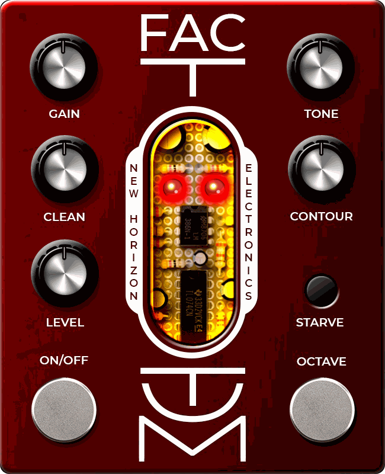

# Factotum

*New Horizon Electronics · a drive that does a bit of everything, for MOD Duo, Duo X and Dwarf*

## Jack of all trades

The Factotum started life as a tribute to the EAE Parallel Universe and wandered off to become its
own thing. At its heart is an LM386: the little chip amp that's been making tiny practice amps
sound huge for decades. Around it sit a clean blend that keeps your pick attack in the room, a
mid-scoop borrowed from the Marshall Shredmaster, a supply you can starve until it sputters, and a
vintage octave-up on its own footswitch.

Overdrive, fuzz, gated splutter, scooped metal, ring-mod-ish octave squeal. It's all in there.

## The controls

- **Gain**: how hard the LM386 gets pushed. Low is a gritty boost, high is a squared-off fuzz.
- **Clean**: how much clean signal is blended in underneath, Klon-style. It follows the Gain knob:
  lots of clean at low gain, a touch at high gain. 0 is fuzz only, 10 is a lot of you.
- **Level**: output volume. Noon is roughly unity, 10 is a serious boost.
- **Tone**: a treble cut, from dark-but-useful (2 kHz) to wide open (8 kHz).
- **Contour**: the Shredmaster's mid scoop. 0 is flat, noon takes a decent bite out of the mids,
  10 is the full scoop.
- **Starve**: drops the chip's supply to about 3.6 V. Lower, more lopsided clipping, and quiet notes
  gate and sputter as they decay. Volume is matched from about noon on the Gain knob up, so you can stomp it mid-song.
- **Octave** (footswitch): a Foxx Tone Machine-style octave up. Germanium diodes fold the wave in
  half, so the pitch doubles. Best on single notes above the 12th fret, Blue Orchid-style.
- **On/Off** (footswitch).

## The light panel

The window in the middle of the pedal shows the circuit board, lit from behind. It glows as you
play and fades as notes die away. Starve switches the light from red-orange to yellow. The two LEDs
are the On/Off (left) and Octave (right) status lights.

## Presets

| Preset | What it is |
| --- | --- |
| A bit of an edge | Light drive, a touch of scoop |
| Death Valley | Starved and dark |
| Bass sic | Starved fuzz with the octave, plenty of clean underneath |
| Blown speaker | Full gain, no scoop, flappy |
| 7ender 8lender | Octave fuzz, wide open, lots of clean |
| Dandy Warhol | Big fuzz with a strong clean blend |
| Garage Fuzz | Everything on, no clean: raw and spitting |
| Clean presence | Gain at 0: a starved, octaved clean boost |
| Mid boost OD | Medium drive, a moderate scoop |
| Contour Fuzz | Starved fuzz, barely scooped |
| Contour Fuzz II | Starved fuzz, more scoop, all the clean |

## Install

1. Connect your MOD by USB.
2. Open [builder.mod.audio](https://builder.mod.audio/buildroot) in Chrome and upload
   `mod-plugin-builder/nhe-factotum/nhe-factotum.mk` from this repo.
3. When the build finishes, click **Install**. Factotum appears under Distortion.

Mono in, mono out. Light on CPU.

## Credits and licence

Designed by Niels, New Horizon Electronics. Started from Colin Raffel's 2006 schematic of the
Electronic Audio Experiments Parallel Universe, with thanks to Colin. The Contour network's
transfer function follows davemollen's [dm-Shredmaster](https://github.com/davemollen/dm-Shredmaster).

Code GPL-3.0-or-later (`LICENSE`). Artwork © 2026 New Horizon Electronics (`ARTWORK-LICENSE.md`).
Built with [DPF](https://github.com/DISTRHO/DPF) and the
[MOD plugin playbook](https://github.com/Kiwooky/MOD-plugin-playbook).

Building it yourself, the tests and how it works inside: [`DEVELOPER-NOTES.md`](DEVELOPER-NOTES.md)
and [`docs/spec.md`](docs/spec.md).
